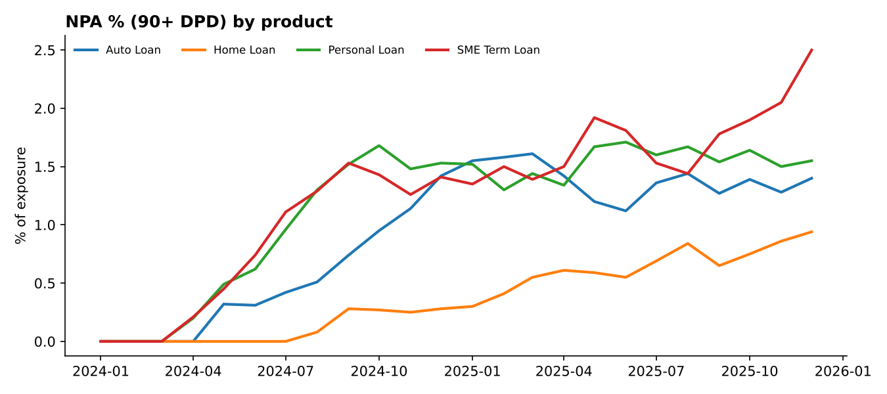
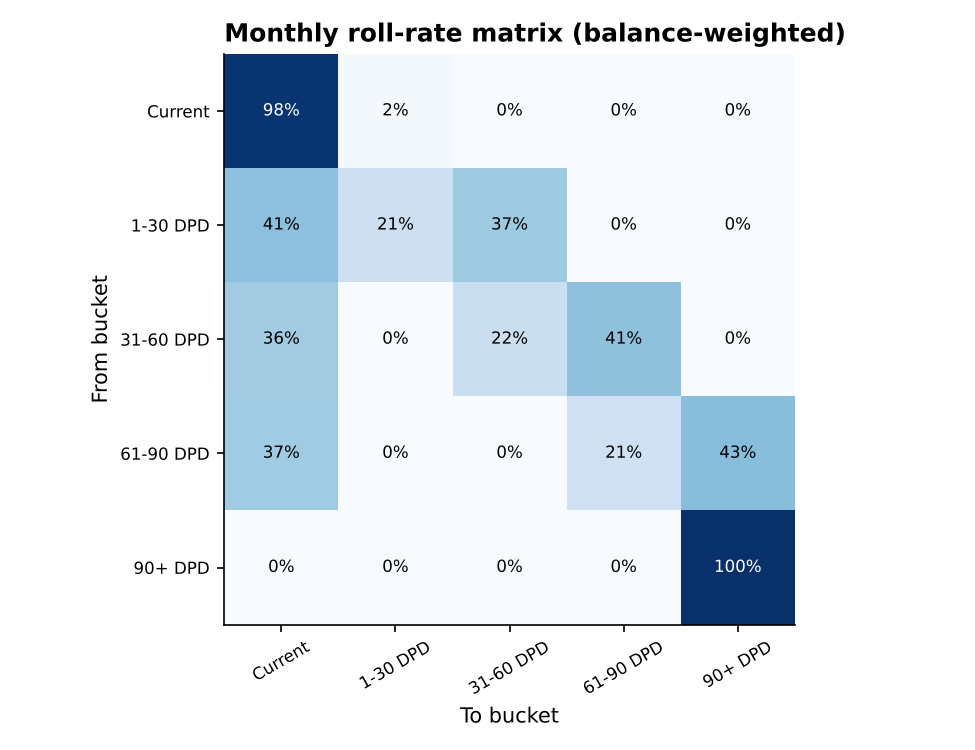
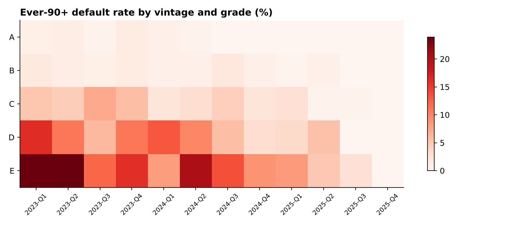

# Credit Risk Reporting Pipeline

A monthly credit-risk reporting pipeline for a retail and SME loan book. It takes raw loan and repayment data, checks it, runs the risk queries in SQL and publishes an Excel risk pack, plus extracts that a BI tool can read directly.

I built it to practise the reporting work a bank risk team does every month: arrears and NPA tracking, roll rates, vintage default curves and concentration. The SQL layer runs locally on DuckDB and runs unchanged on **AWS Athena**, with the dashboard in **Amazon QuickSight**.



## What it does

```
generate_data.py  ->  dq_checks.py  ->  sql/*.sql (DuckDB or Athena)  ->  build_report.py
  raw CSVs            clean parquet       portfolio, DPD, roll rates,       Excel risk pack
                      + quarantine        vintage, concentration            + CSV extracts + charts
```

1. **Data.** About 12,000 loans across personal, auto, SME and home loans, with 24 monthly performance snapshots (Jan 2024 to Dec 2025, roughly 180K rows). The data is synthetic, but it behaves like a real book. Riskier grades miss payments more often, arrears either cure or roll forward, and loans are written off after six months at 90+ days past due.
2. **Data quality.** Before anything is reported, 11 checks run: duplicates, missing or invalid grades, impossible interest rates, negative balances, performance rows with no matching loan, and duplicate loan-months. Rows that fail a critical check are **quarantined with a reason**, not silently dropped. A few dozen records are broken on purpose so the checks have real work to do.
3. **SQL.** Five queries in plain ANSI-style SQL:
   - `01_portfolio_summary`: exposure, accounts, arrears % and NPA % by month and product
   - `02_delinquency_buckets`: latest balance by grade and DPD bucket
   - `03_roll_rates`: month-on-month movement between buckets, using a self-join and window functions
   - `04_vintage_default`: share of each origination quarter that ever hit 90+ DPD, by grade
   - `05_concentration`: exposure share by region and product
4. **Report.** An Excel pack with a one-page summary, so a reviewer gets the headline before the detail. Every summary KPI is a formula on the trend sheet, so it updates if the data changes. The pack also has native Excel charts, conditional formatting on the roll-rate and vintage tables, and a data-quality tab.

## Results from the latest run (Dec 2025)

| KPI | Dec 2025 | Nov 2025 |
|---|---|---|
| Exposure | ₹1,494 cr | ₹1,463 cr |
| Arrears % | 4.78% | 4.58% |
| NPA % (90+ DPD) | 1.40% | 1.23% |
| Data-quality checks failed | 6 of 11 | |
| Rows stopped before reporting | 395 | |

Grade E loans default at about 30 times the rate of grade A (12.3% vs 0.4%). SME and personal loans carry the most arrears. About 41% of 1-30 DPD balance cures each month, while about 37% rolls into the next bucket.

| Roll rates | Vintage default |
|---|---|
|  |  |

## Run it

```bash
pip install -r requirements.txt
python run_pipeline.py        # data -> checks -> SQL -> report (about 30 seconds)
pytest -q                     # unit tests for the data-quality rules
```

Outputs:
- `reports/credit_risk_report_<month>.xlsx`: the risk pack
- `reports/extracts/*.csv`: one file per query, ready for Power BI, Tableau or QuickSight
- `data/clean/quarantine.csv`: every rejected row with the rule it broke

## Running on AWS (free tier)

```bash
aws configure                                   # your own account
./aws/setup.sh my-credit-risk-bucket ap-south-1  # uploads parquet to S3, creates Athena tables
```

The queries in `sql/` then run in Athena as they are (prefix tables with `credit_risk.`). `aws/quicksight_guide.md` walks through building the dashboard in QuickSight on top of them.

## Project layout

```
src/generate_data.py   synthetic loan book + performance history
src/dq_checks.py       data-quality rules, quarantine, DQ summary
src/build_report.py    runs SQL, writes Excel pack, extracts and charts
sql/                   the five risk queries (DuckDB / Athena)
aws/                   S3 + Athena setup script, DDL, QuickSight guide
tests/                 pytest for the DQ rules
reports/               sample output from the last run
```

## Tech

Python (pandas, NumPy), SQL (DuckDB locally, AWS Athena in the cloud), AWS S3, Amazon QuickSight, openpyxl, matplotlib, pytest.

*All data in this repo is synthetic. No real customer information is used.*
